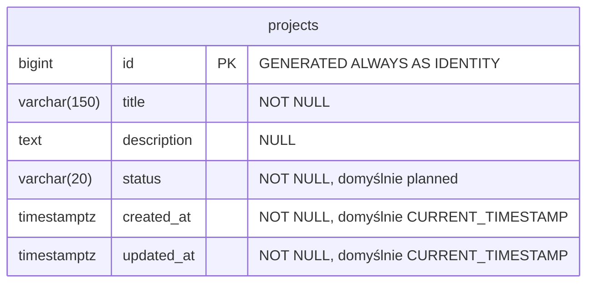

# Projekty — etap 2

Tabela `public.projects` przechowuje projekty zgodnie z modelem z laboratorium.
Połączenie z bazą wykorzystuje środowisko przygotowane w
[etapie 1](postgresql-environment.md).

## ERD



| Kolumna | Reguła |
| --- | --- |
| `id` | Automatyczny identyfikator i klucz główny. |
| `title` | Wymagany tytuł, maksymalnie 150 znaków. |
| `description` | Opcjonalny opis; może mieć wartość `NULL`. |
| `status` | `planned`, `active` lub `completed`; domyślnie `planned`. |
| `created_at` | Data utworzenia ze strefą czasową. |
| `updated_at` | Data ostatniej zmiany ze strefą czasową. |

`projects_status_check` wymusza dozwolone statusy w bazie.
Indeks klucza głównego jest tworzony automatycznie. Dodatkowe indeksy to
`projects_status_idx` dla statusu i `projects_created_at_idx` dla daty utworzenia
w kolejności malejącej.

Obie daty otrzymują wartość domyślną podczas dodawania rekordu. `updated_at`
nie zmienia się automatycznie przy `UPDATE`: jego aktualizację zapewni
repozytorium w kolejnym etapie. Na tym etapie diagram zawiera jedną encję.

## Utworzenie tabeli

Polecenia uruchom z katalogu projektu w Windows CMD. Używają ustawień
`POSTGRES_USER` i `POSTGRES_DB` wewnątrz kontenera, bez wpisywania danych
logowania do poleceń.

Najpierw sprawdź, czy tabela już istnieje (`f` oznacza brak, `t` — istnienie):

```cmd
echo SELECT to_regclass('public.projects') IS NOT NULL; | docker compose exec -T db sh -c "PGUSER=$POSTGRES_USER PGDATABASE=$POSTGRES_DB exec psql -X -v ON_ERROR_STOP=1 -At"
```

Jeśli wynik to `f`, wykonaj skrypt jeden raz:

```cmd
docker compose exec -T db sh -c "PGUSER=$POSTGRES_USER PGDATABASE=$POSTGRES_DB exec psql -X -v ON_ERROR_STOP=1" < database\01-create-projects.sql
```

Skrypt tworzy tabelę i indeksy w jednej transakcji. Ponowne wykonanie kończy się
błędem o istniejącej tabeli; nie zastępuje jej ani nie usuwa zapisanych projektów.
Opcja `ON_ERROR_STOP=1` zatrzymuje `psql` po błędzie i zwraca niezerowy kod wyjścia.

Sprawdź strukturę:

```cmd
echo \d public.projects | docker compose exec -T db sh -c "PGUSER=$POSTGRES_USER PGDATABASE=$POSTGRES_DB exec psql -X -v ON_ERROR_STOP=1"
```

Wynik powinien zawierać sześć kolumn, klucz główny, ograniczenie
`projects_status_check` oraz dwa dodatkowe indeksy.

## Sprawdzenie ograniczeń

```cmd
docker compose exec -T db sh -c "PGUSER=$POSTGRES_USER PGDATABASE=$POSTGRES_DB exec psql -X -v ON_ERROR_STOP=1" < scripts\check-projects.sql
```

Prawidłowy wynik zawiera dziewięć komunikatów `[OK]` oraz końcowe `ROLLBACK`.
Testy sprawdzają wartości domyślne, generowanie identyfikatorów, opcjonalny opis,
trzy dozwolone statusy, limit tytułu i odrzucanie wartości `NULL` w wymaganych
kolumnach oraz powtórzonego identyfikatora.

Skrypt tworzy tymczasową kopię definicji tabeli z własną sekwencją identity.
Nie zapisuje testowych projektów w `public.projects` i nie zmienia jej numeracji.
Samo `ROLLBACK` zwykłych zapisów do docelowej tabeli nie cofnęłoby sekwencji,
dlatego testy korzystają z oddzielnej tabeli tymczasowej.
